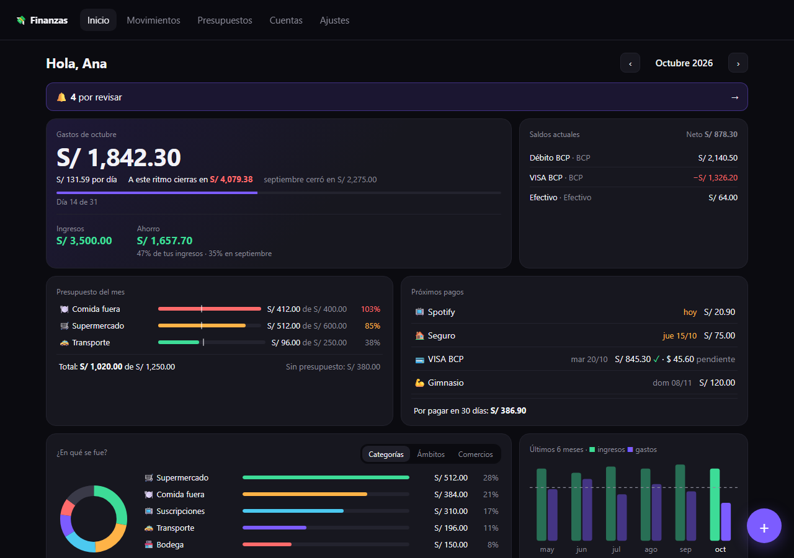
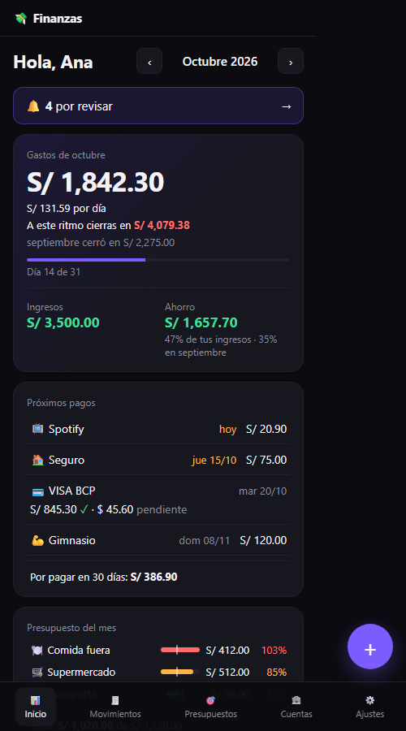
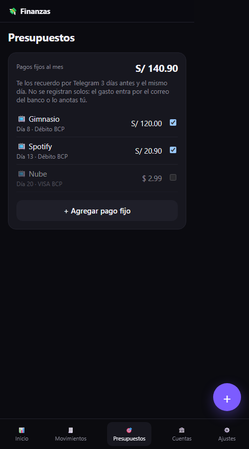
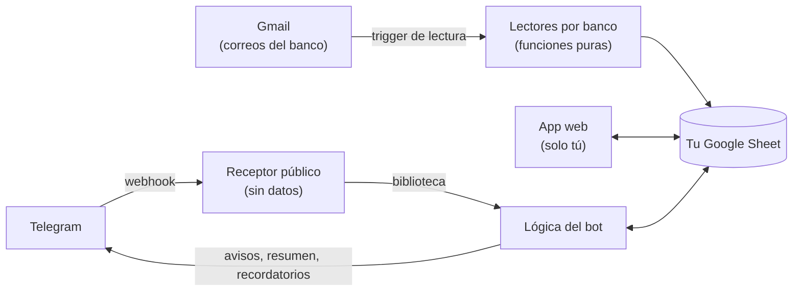

# 💸 Finanzas personales

[](https://github.com/BrunoRioja/finanzas-personales/actions/workflows/ci.yml)


> **EN —** Self-hosted personal finance app built on Google Apps Script + Google Sheets. Each person runs their own copy in their own Google account: no servers, no shared data. It reads bank notification emails (BCP, Yape), has a Telegram bot that only asks about what it doesn't recognize, tracks monthly budgets and upcoming card and fixed payments. Install it with one "Make a copy" click. Gemini (receipts) is future work.

App de finanzas personales que vive en **tu propia cuenta de Google**: lee los correos de tu banco, te pregunta por Telegram solo lo que no reconoce y te muestra en qué se va tu dinero, cuánto llevas de tu presupuesto y qué pagos vienen.

**[📄 Hacer una copia](https://docs.google.com/spreadsheets/d/12jTo7S7wRd1xs4XMN9ftS2PyDjCArfTAaT6gun2GemE/copy)** · 4 pasos, sin programar: [cómo instalarla](docs/instalacion.md)

| Laptop | Celular |
|---|---|
|  |  |

## Qué hace (v0.8)

- **Lee los correos de tu banco** (BCP y Yape): consumos con débito y crédito en S/ y $, PLIN, yapeos enviados y recibidos, transferencias, pagos de tarjeta y de servicios. Lo que no sabe categorizar va a una bandeja "Por revisar" y se resuelve con un toque.
- **Bot de Telegram:** te pregunta solo por las compras que no reconoce, registra lo que escribes (`taxi 12 yape`), responde `/hoy`, `/mes`, `/pagos` y `/deshacer`, y te manda un resumen al final del día.
- **Ámbitos de gasto** (Personal, Diversión, Familia, Trabajo), editables, con análisis en el Inicio.
- **Presupuestos por categoría:** con lo del mes pasado como referencia; el Inicio muestra cuánto llevas y el bot te avisa al 80 % y al 100 %.
- **Próximos pagos:** lee el estado de cuenta de tu tarjeta (total, mínimo y fecha límite en S/ y $), sabe qué parte ya pagaste y te recuerda tus pagos fijos y la tarjeta 3 días antes y el mismo día.
- **Dashboard y movimientos:** gasto del mes con ritmo diario y proyección a fin de mes; ingresos, ahorro y tasa; saldos con total neto; "¿En qué se fue?" por categoría, ámbito o comercio; tendencia de 6 meses con promedio; dividir una compra entre categorías.
- **Instalación con "Hacer una copia"**, actualización importando tus datos y **modo demo** con datos ficticios.



## Cómo funciona



Todo corre en tu cuenta de Google: Apps Script lee tus correos, guarda en tu hoja y publica la app solo para ti. El único punto público es el receptor del bot, que no guarda nada y solo acepta mensajes con un secreto.

## Hoja de ruta

| Versión | Qué agrega | Estado |
|---|---|---|
| v0.1 | Núcleo, dashboard, registro manual, asistente, demo | ✅ |
| v0.2 | Lectura automática de correos del banco (BCP, Yape), bandeja y dividir | ✅ |
| v0.3 | Bot de Telegram: solo pregunta lo que no conoce, resumen diario | ✅ |
| v0.4 | Gemini: foto de boleta para dividir compras (a decidir con el uso real) | ⏸️ |
| v0.5 | Presupuestos por categoría y avisos por Telegram | ✅ |
| v0.6 | Próximos pagos: estado de cuenta de la tarjeta y pagos recurrentes | ✅ |
| v0.7 | Plantilla "Hacer una copia" y pulido del README | ✅ |

## Instalación

- **Sin programar (recomendado):** [Hacer una copia](https://docs.google.com/spreadsheets/d/12jTo7S7wRd1xs4XMN9ftS2PyDjCArfTAaT6gun2GemE/copy) y seguir los 4 pasos de [docs/instalacion.md](docs/instalacion.md). El bot de Telegram es opcional: [docs/telegram.md](docs/telegram.md). Para actualizar: [docs/actualizar.md](docs/actualizar.md).
- **Para desarrolladores (clasp):**

```bash
git clone https://github.com/BrunoRioja/finanzas-personales.git
cd finanzas-personales
npm install
npx clasp login
npm run setup      # crea tu Google Sheet y el proyecto de Apps Script
git checkout src/appsscript.json
npm run deploy     # sube el código y publica la web app (solo tú puedes abrirla)
```

## Decisiones técnicas

- **Apps Script + Google Sheets:** gratis, sin servidores, los datos quedan en la cuenta de cada persona y se pueden abrir y exportar como cualquier hoja.
- **Lógica pura separada de Google:** `src/core/` no depende de servicios de Google, así que se prueba en Node con un arnés que simula Sheets (`tests/harness.js`). Solo `src/core/repo.js` toca la hoja.
- **Sin doble conteo:** pagar la tarjeta o mover plata entre tus cuentas es una *transferencia*, no un gasto. El gasto se cuenta una sola vez, cuando compras.
- **Multimoneda simple:** cada movimiento guarda su moneda original y su equivalente en soles con el tipo de cambio; el dashboard suma en soles.
- **Columnas por encabezado:** la app ubica cada columna por su nombre, así que puedes reordenar columnas o agregar las tuyas en la hoja sin romper nada.
- **Lectores deterministas por banco:** cada banco es una función pura con sus correos de ejemplo anonimizados como pruebas; agregar uno no toca el resto ([docs/agregar-un-banco.md](docs/agregar-un-banco.md)). Un correo que no se entiende queda visible en la bandeja, nunca se pierde.
- **Gmail con el permiso mínimo útil:** `gmail.modify` solo para buscar, leer y etiquetar; la app recuerda qué correos ya leyó por su id, no por la etiqueta.
- **Bot sin abrir la app:** un receptor público mínimo recibe el webhook de Telegram y usa la app como biblioteca; la app y los datos siguen siendo "solo yo" ([docs/arquitectura.md](docs/arquitectura.md)).

- **Copia congelada en vez de biblioteca compartida:** cada copia ejecuta su propio código; nadie (ni el autor) puede cambiarlo desde afuera. Las versiones nuevas se buscan con un botón en Ajustes y se instalan copiando la plantilla e importando los datos.
- **Importación por encabezados:** una hoja de cualquier versión anterior se importa leyendo cada columna por su nombre; lo que no existía queda vacío y la migración completa el resto.

Más detalle en [docs/arquitectura.md](docs/arquitectura.md) y el diseño completo en [docs/superpowers/specs](docs/superpowers/specs/2026-10-13-app-finanzas-design.md).

## Calidad y desarrollo

- **Pruebas:** unas 250 pruebas con `node:test` sobre un arnés (`tests/harness.js`) que simula Sheets, Gmail, Telegram, triggers, propiedades y caché, así que todo el flujo (correo → movimiento → aviso por Telegram) se prueba sin tocar Google.
- **Correos reales anonimizados** como casos de prueba de cada lector.
- **CI** en GitHub Actions (pruebas + ESLint) en cada push.
- **Interfaz revisada en Chrome** a 390 px y 1280 px con datos simulados.

```bash
npm test          # pruebas
npm run lint      # ESLint
npm run ui -- "mostrar('movimientos')" vista captura.png 420   # captura de la interfaz con datos simulados
```

## Privacidad

Tus datos viven solo en tu Google Sheet. Lee [docs/privacidad.md](docs/privacidad.md).

## Licencia

[MIT](LICENSE)
