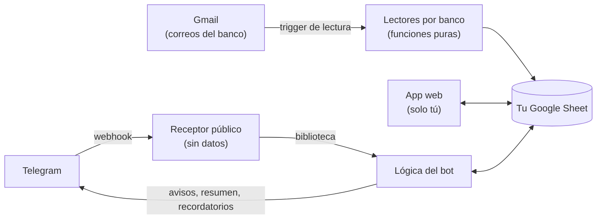

# Fase 5c · Plantilla "Hacer una copia" y README — Plan de implementación

> **For agentic workers:** REQUIRED SUB-SKILL: Use superpowers:subagent-driven-development (recommended) or superpowers:executing-plans to implement this plan task-by-task. Steps use checkbox (`- [ ]`) syntax for tracking.

**Goal:** Que cualquier persona instale su propia app copiando una hoja plantilla, vea su versión, se entere de versiones nuevas y traiga sus datos de una copia anterior. Además, dejar el README listo para portafolio.

**Architecture:**
- La plantilla es una Google Sheet con el código de `src/` vinculado. Se mantiene con `npm run deploy:plantilla` y nunca se publica.
- `src/web/menu.js` agrega el menú 💸 Finanzas en la hoja.
- `src/core/version.js` y `src/web/api-version.js` muestran la versión y consultan la última publicada en GitHub.
- `src/setup/importar.js` copia los datos de otra hoja de la app, leyéndolos por encabezados.
- `leerTabla_` se divide para poder leer otro libro con la misma lógica.

**Tech Stack:** Google Apps Script V8, Google Sheets, HtmlService. Pruebas con `node --test` sobre el arnés vm de `tests/harness.js`, ESLint 9 y clasp 3.4.1.

**Spec:** [docs/superpowers/specs/2026-10-14-fase-5c-plantilla-design.md](../specs/2026-10-14-fase-5c-plantilla-design.md)

## Global Constraints

- La plantilla nunca se publica ni ejecuta código: al copiar la hoja, Google copia también las Script Properties del proyecto, y no debe haber ninguna.
- No hay permisos OAuth nuevos. `SpreadsheetApp.getUi()` usa el scope de spreadsheets y la consulta a GitHub usa `script.external_request`, que ya existen.
- La consulta de versión no envía datos del usuario, nunca lanza, y guarda su resultado 12 horas en `CacheService` con la clave `ULTIMA_VERSION`, incluso cuando falla.
- Al importar se copian Cuentas, Categorias, Movimientos, Divisiones, Reglas, Presupuestos, Recurrentes y EstadosCuenta.
  - De Config solo se copian `nombre`, `moneda_principal`, `ultimo_tc`, `hora_resumen`, `horario_inicio`, `horario_fin` y `etiquetar`.
  - Nunca se copian Log, Pendientes ni la configuración de lectura.
- Toda escritura va dentro de `conBloqueo_`, y las funciones públicas no llevan `_`. Lo que va a HTML se escapa: `esc()` en la interfaz y `escaparAtributo_` en los diálogos de la hoja.
- Nada personal en el repo: los datos de prueba, los placeholders y las capturas son ficticios.
- `VERSION_APP` siempre es igual a `version` de `package.json`.
- Textos de interfaz en español peruano, sin `alert`, `confirm` ni `prompt`.

## Review Focus

1. **Importar estando en modo demo.** La persona tocó "Solo mirar (datos demo)" en la copia nueva y luego intenta importar. Debe pedirle que salga del modo demo, no escribir en la hoja demo. → Task 3, test `valida el enlace…`.
2. **Hoja anterior de una versión vieja.** Sin las hojas Presupuestos, Recurrentes o EstadosCuenta, y con el encabezado `ultimos4`. Debe importar lo que haya y dejar vacío lo demás. → Task 3, test `importa una hoja de una versión anterior…`.
3. **GitHub caído o lento al abrir Ajustes.** Ajustes debe abrir igual, sin aviso de versión nueva, y no insistir en cada apertura. → Task 1, test `sin versión nueva o con GitHub caído…`.
4. **Una URL con comillas o `<` en el diálogo del menú.** No debe romper ni inyectar HTML. → Task 2, test `htmlEnlaceApp_ escapa la URL`.
5. **`npm run deploy:plantilla` apuntando por error a la app o al receptor.** Debe negarse antes de subir nada. → Task 5, chequeo en el script y Step 3 de verificación.

---

### Task 1: Versión de la app y aviso de versión nueva

**Files:**
- Create: `src/core/version.js`, `src/web/api-version.js`
- Modify: `tests/harness.js` (`crearUrlFetch`, `crearEntorno`)
- Test: `tests/version.test.js` (nuevo)

**Interfaces:**
- Produces:
  - `VERSION_APP` (texto; en esta tarea `'0.6.0'`, y Task 6 lo sube a `'0.7.0'`)
  - `URL_REPO`
  - `compararVersiones_(a, b) → -1|0|1`
  - `ultimaVersionPublicada_() → texto`
  - `estadoVersion() → { actual, ultima, hayNueva, repo, cambios, actualizar }`
  - En el arnés: `e.github = { version, falla, llamadas }`

- [ ] **Step 1: Simular GitHub en el arnés**

En `tests/harness.js`:
- Agregar arriba de `function crearUrlFetch`:

```js
const URL_PAQUETE = 'https://raw.githubusercontent.com/BrunoRioja/finanzas-personales/main/package.json';
```

- Cambiar la firma a `function crearUrlFetch(estado, github) {` y agregar como primera línea dentro de `fetch: (url, o) => {`:

```js
      if (url === URL_PAQUETE) {
        github.llamadas++;
        if (github.falla) throw new Error('Address unavailable: ' + url);
        return { getResponseCode: () => 200, getContentText: () => JSON.stringify({ name: 'finanzas-personales', version: github.version }) };
      }
```

- En `crearEntorno`:
  - Después de `const telegram = …;`, agregar `const github = { version: '0.0.0', falla: false, llamadas: 0 };`.
  - Cambiar `UrlFetchApp: crearUrlFetch(telegram),` por `UrlFetchApp: crearUrlFetch(telegram, github),`.
  - Agregar `github,` al objeto que se devuelve, junto a `telegram, cache,`.

- [ ] **Step 2: Escribir las pruebas que fallan**

Crear `tests/version.test.js`:

```js
const test = require('node:test');
const assert = require('node:assert');
const { crearEntorno } = require('./harness');
const paquete = require('../package.json');

const REPO = 'https://github.com/BrunoRioja/finanzas-personales';

test('la versión de la app es la del package.json', () => {
  const e = crearEntorno();
  assert.strictEqual(e.llamar('estadoVersion').actual, paquete.version);
});

test('compararVersiones_ compara número por número', () => {
  const e = crearEntorno();
  const c = (a, b) => e.llamar('compararVersiones_', a, b);
  assert.strictEqual(c('0.10.0', '0.9.0'), 1);
  assert.strictEqual(c('0.7.0', '0.7.0'), 0);
  assert.strictEqual(c('0.7.0', '1.0.0'), -1);
  assert.strictEqual(c('basura', '0.0.1'), -1);
  assert.strictEqual(c('', '0.0.0'), 0);
});

test('estadoVersion avisa si en GitHub hay una versión mayor y guarda la respuesta 12 horas', () => {
  const e = crearEntorno();
  e.github.version = '9.0.0';
  assert.deepStrictEqual(e.llamar('estadoVersion'), {
    actual: paquete.version, ultima: '9.0.0', hayNueva: true, repo: REPO,
    cambios: REPO + '/blob/main/CHANGELOG.md', actualizar: REPO + '/blob/main/docs/actualizar.md',
  });
  e.llamar('estadoVersion');
  assert.strictEqual(e.github.llamadas, 1);
  assert.strictEqual(e.cache.ULTIMA_VERSION, '9.0.0');
});

test('sin versión nueva o con GitHub caído no hay aviso y no lanza', () => {
  const e = crearEntorno();
  e.github.version = paquete.version;
  assert.strictEqual(e.llamar('estadoVersion').hayNueva, false);
  const caido = crearEntorno();
  caido.github.falla = true;
  const v = caido.llamar('estadoVersion');
  assert.strictEqual(v.ultima, '');
  assert.strictEqual(v.hayNueva, false);
  caido.llamar('estadoVersion');
  assert.strictEqual(caido.github.llamadas, 1, 'el fallo también se guarda para no insistir');
});
```

- [ ] **Step 3: Verificar que fallan**

Run: `node --test tests/version.test.js`
Expected: FAIL, 4/4, con `contexto[nombre] is not a function`.

- [ ] **Step 4: Implementar**

Crear `src/core/version.js`:

```js
// Versión de esta copia de la app. Una prueba exige que sea la de package.json.
const VERSION_APP = '0.6.0';
const URL_REPO = 'https://github.com/BrunoRioja/finanzas-personales';

function partesVersion_(v) {
  const m = /^(\d+)\.(\d+)\.(\d+)$/.exec(String(v == null ? '' : v).trim());
  return m ? [Number(m[1]), Number(m[2]), Number(m[3])] : [0, 0, 0];
}

// Por número en cada parte: 0.10.0 es mayor que 0.9.0. Un texto inválido vale 0.0.0.
function compararVersiones_(a, b) {
  const x = partesVersion_(a);
  const y = partesVersion_(b);
  for (let i = 0; i < 3; i++) {
    if (x[i] !== y[i]) return x[i] > y[i] ? 1 : -1;
  }
  return 0;
}
```

Crear `src/web/api-version.js`:

```js
// Sección "Acerca de" de Ajustes: versión instalada y aviso si hay una más nueva. Solo
// lee el package.json público del repositorio; no envía ningún dato de la persona.

const URL_PAQUETE_PUBLICADO = 'https://raw.githubusercontent.com/BrunoRioja/finanzas-personales/main/package.json';
const SEGUNDOS_CACHE_VERSION = 43200;

// Nunca lanza. El resultado (también '' si falla) se guarda 12 horas para no insistir.
function ultimaVersionPublicada_() {
  const cache = CacheService.getScriptCache();
  const guardada = cache.get('ULTIMA_VERSION');
  if (guardada !== null) return guardada;
  let version = '';
  try {
    const r = UrlFetchApp.fetch(URL_PAQUETE_PUBLICADO, { muteHttpExceptions: true });
    if (r.getResponseCode() === 200) version = String(JSON.parse(r.getContentText()).version || '');
  } catch {
    version = '';
  }
  cache.put('ULTIMA_VERSION', version, SEGUNDOS_CACHE_VERSION);
  return version;
}

function estadoVersion() {
  const ultima = ultimaVersionPublicada_();
  return {
    actual: VERSION_APP, ultima: ultima, hayNueva: compararVersiones_(ultima, VERSION_APP) > 0, repo: URL_REPO,
    cambios: URL_REPO + '/blob/main/CHANGELOG.md', actualizar: URL_REPO + '/blob/main/docs/actualizar.md',
  };
}
```

- [ ] **Step 5: Verificar que pasan**

Run: `node --test tests/version.test.js`
Expected: PASS, 4/4.

- [ ] **Step 6: Suite, lint y commit**

Run: `npm test && npm run lint`
Expected: verde y lint limpio.

```bash
git add src/core/version.js src/web/api-version.js tests/harness.js tests/version.test.js
git commit -m "feat: versión de la app y aviso de versión nueva desde GitHub"
```

---

### Task 2: Menú 💸 Finanzas en la hoja

**Files:**
- Create: `src/web/menu.js`
- Modify: `tests/harness.js` (`crearScriptApp`, `crearEntorno`: `SpreadsheetApp.getUi`, `HtmlService`, `opciones.idPrincipal`)
- Test: `tests/menu.test.js` (nuevo)

**Interfaces:**
- Produces:
  - `onOpen()`, `abrirMiApp()`, `comoPublicarMiApp()`
  - `htmlEnlaceApp_(url)`, `textoPublicarApp_()`, `escaparAtributo_(texto)`
  - En el arnés: `e.ui = { menus, dialogos }`, `e.servicio = { url }` y `crearEntorno({ idPrincipal })`

- [ ] **Step 1: Arnés: interfaz de la hoja, HtmlService y URL configurable**

En `tests/harness.js`:
- Cambiar `function crearScriptApp(triggers, permisos) {` por `function crearScriptApp(triggers, permisos, servicio) {` y su línea `getService` por:

```js
    getService: () => ({ getUrl: () => servicio.url }),
```

- En `crearEntorno`:
  - Cambiar `const principal = crearLibro('libro-principal', opciones.hojas || {});` por `const principal = crearLibro(opciones.idPrincipal || 'libro-principal', opciones.hojas || {});`.
  - Después de `const github = …;`, agregar:

```js
  const servicio = { url: 'https://script.google.com/macros/s/APP-PRUEBA/exec' };
  const ui = {
    menus: [], dialogos: [],
    createMenu: titulo => {
      const menu = { titulo: titulo, items: [] };
      const b = { addItem: (texto, funcion) => { menu.items.push([texto, funcion]); return b; }, addToUi: () => { ui.menus.push(menu); } };
      return b;
    },
    showModalDialog: (salida, titulo) => { ui.dialogos.push({ titulo: titulo, html: salida.getContent() }); },
  };
```

  - Dentro de `SpreadsheetApp: {`, agregar `getUi: () => ui,`.
  - Agregar al contexto, junto a `Utilities`:

```js
    HtmlService: {
      createHtmlOutput: html => {
        const salida = { setWidth: () => salida, setHeight: () => salida, getContent: () => String(html) };
        return salida;
      },
    },
```

  - Cambiar `ScriptApp: crearScriptApp(triggers, permisosPedidos),` por `ScriptApp: crearScriptApp(triggers, permisosPedidos, servicio),`.
  - Agregar `ui, servicio,` al objeto que se devuelve.

- [ ] **Step 2: Escribir las pruebas que fallan**

Crear `tests/menu.test.js`:

```js
const test = require('node:test');
const assert = require('node:assert');
const { crearEntorno } = require('./harness');

test('onOpen agrega el menú 💸 Finanzas con sus dos opciones', () => {
  const e = crearEntorno();
  e.llamar('onOpen');
  assert.deepStrictEqual(e.ui.menus, [{
    titulo: '💸 Finanzas', items: [['Abrir mi app', 'abrirMiApp'], ['Cómo publicar mi app', 'comoPublicarMiApp']],
  }]);
});

test('Abrir mi app muestra el enlace si está publicada y los pasos si no', () => {
  const e = crearEntorno();
  e.llamar('abrirMiApp');
  assert.strictEqual(e.ui.dialogos[0].titulo, 'Tu app');
  assert.match(e.ui.dialogos[0].html, /href="https:\/\/script\.google\.com\/macros\/s\/APP-PRUEBA\/exec"/);
  e.servicio.url = null;
  e.llamar('abrirMiApp');
  assert.strictEqual(e.ui.dialogos[1].titulo, 'Cómo publicar tu app');
  assert.match(e.ui.dialogos[1].html, /Nueva implementación/);
  assert.match(e.ui.dialogos[1].html, /no verificó/);
  e.llamar('comoPublicarMiApp');
  assert.strictEqual(e.ui.dialogos[2].html, e.ui.dialogos[1].html);
});

test('htmlEnlaceApp_ escapa la URL', () => {
  const e = crearEntorno();
  const html = e.llamar('htmlEnlaceApp_', 'https://x/"><script>alert(1)</script>');
  assert.ok(!html.includes('<script>'));
  assert.match(html, /&quot;&gt;&lt;script&gt;/);
});
```

- [ ] **Step 3: Verificar que fallan**

Run: `node --test tests/menu.test.js`
Expected: FAIL, 3/3, con `contexto[nombre] is not a function`.

- [ ] **Step 4: Implementar**

Crear `src/web/menu.js`:

```js
// Menú "💸 Finanzas" de la Google Sheet: lleva a la app o explica cómo publicarla. En una
// copia recién hecha de la plantilla, "Abrir mi app" es lo primero que pide permisos.

const TITULO_MENU = '💸 Finanzas';

// Trigger simple: corre al abrir la hoja, sin permisos, así que solo arma el menú.
function onOpen() {
  SpreadsheetApp.getUi().createMenu(TITULO_MENU)
    .addItem('Abrir mi app', 'abrirMiApp')
    .addItem('Cómo publicar mi app', 'comoPublicarMiApp')
    .addToUi();
}

function abrirMiApp() {
  const url = ScriptApp.getService().getUrl() || '';
  if (!url) return comoPublicarMiApp();
  return mostrarDialogo_(htmlEnlaceApp_(url), 'Tu app');
}

function comoPublicarMiApp() {
  return mostrarDialogo_(textoPublicarApp_(), 'Cómo publicar tu app');
}

function mostrarDialogo_(html, titulo) {
  const salida = HtmlService.createHtmlOutput('<div style="font-family:Arial,sans-serif;font-size:14px;line-height:1.5">' + html + '</div>')
    .setWidth(460).setHeight(440);
  SpreadsheetApp.getUi().showModalDialog(salida, titulo);
}

function escaparAtributo_(texto) {
  return String(texto == null ? '' : texto).replace(/[&<>"']/g, c => ({ '&': '&amp;', '<': '&lt;', '>': '&gt;', '"': '&quot;', "'": '&#39;' }[c]));
}

function htmlEnlaceApp_(url) {
  const u = escaparAtributo_(url);
  return '<p>Tu app está publicada. Ábrela y guárdala en favoritos (o en la pantalla de inicio del celular):</p>' +
    '<p><a href="' + u + '" target="_blank" rel="noopener">Abrir mi app</a></p>' +
    '<p style="word-break:break-all;color:#555">' + u + '</p>';
}

function textoPublicarApp_() {
  return '<p>Tu copia ya tiene todo el código; falta publicarla como app web (solo una vez):</p><ol>' +
    '<li>Menú <b>Extensiones → Apps Script</b>.</li>' +
    '<li>Arriba a la derecha: <b>Implementar → Nueva implementación</b>.</li>' +
    '<li>En el engranaje de "Seleccionar tipo", elige <b>App web</b>.</li>' +
    '<li><b>Ejecutar como:</b> Yo. <b>Quién tiene acceso:</b> Solo yo.</li>' +
    '<li>Toca <b>Implementar</b> y luego <b>Autorizar acceso</b> con tu cuenta.</li>' +
    '<li>Copia la <b>URL de la app web</b> y ábrela. También la verás aquí, en <b>💸 Finanzas → Abrir mi app</b>.</li></ol>' +
    '<p style="color:#555">Si Google muestra "Google no verificó esta app", es porque el código es tuyo y no pasó por su ' +
    'verificación: toca <b>Configuración avanzada</b> y luego <b>Ir a …</b>. Nadie más puede abrir tu app ni ver tus datos.</p>';
}
```

- [ ] **Step 5: Verificar que pasan**

Run: `node --test tests/menu.test.js`
Expected: PASS, 3/3.

- [ ] **Step 6: Suite, lint y commit**

Run: `npm test && npm run lint`
Expected: verde y lint limpio. Las pruebas que usan la URL de la app siguen pasando, porque `servicio.url` tiene el mismo valor por defecto.

```bash
git add src/web/menu.js tests/harness.js tests/menu.test.js
git commit -m "feat: menú 💸 Finanzas en la hoja para abrir o publicar la app"
```

---

### Task 3: Importar datos de la hoja anterior

**Files:**
- Create: `src/setup/importar.js`
- Modify: `src/core/repo.js` (`leerTabla_` → `filasDe_`)
- Test: `tests/importar.test.js` (nuevo)

**Interfaces:**
- Consumes: `crearEntorno({ idPrincipal })` (Task 2), `estaInstalado_`, `estadoActual_`, `crearHojas_`, `agregarFilas_`, `guardarConfig_`, `RENOMBRES_ESQUEMA` y `VERSION_ESQUEMA`.
- Produces:
  - `filasDe_(hoja, nombre)` (repo.js)
  - `idDeHoja_(enlace)`, `leerTablaDe_(libro, nombre)`
  - `importarHojaAnterior(enlace) → { importado: { Cuentas, Categorias, Movimientos, Divisiones, Reglas, Presupuestos, Recurrentes, EstadosCuenta }, estado: { instalado, modoDemo } }`

- [ ] **Step 1: Escribir las pruebas que fallan**

Crear `tests/importar.test.js`:

```js
const test = require('node:test');
const assert = require('node:assert');
const { crearEntorno, crearLibro } = require('./harness');
const { entornoInstalado } = require('./fixtures');

const ID_ANTERIOR = '1AnteriorAnteriorAnterior01';
const ID_NUEVA = '1NuevaNuevaNuevaNuevaNueva02';

// App instalada con datos ficticios: es la "hoja anterior".
function hojaAnterior() {
  const a = entornoInstalado();
  a.llamar('guardarMovimiento', {
    tipo: 'gasto', fecha: '2026-10-05', monto: '45.90', moneda: 'PEN', cuenta_id: a.cuenta('Débito BCP'),
    categoria_id: a.categoria('Supermercado'), comercio: 'Tottus', descripcion: '',
  });
  a.llamar('guardarPresupuestos', { montos: { [a.categoria('Supermercado')]: '600' } });
  a.llamar('guardarRecurrente', {
    nombre: 'Streaming', monto: '20.90', moneda: 'PEN', dia_mes: '5', cuenta_id: a.cuenta('Débito BCP'), categoria_id: a.categoria('Suscripciones'),
  });
  a.interno('guardarConfig_', { lectura_activa: 'si', importar_desde: '2026-09-01', horario_inicio: 8 });
  a.interno('registrarLog_', 'error', 'prueba', 'un error viejo', '');
  return a;
}

// Copia recién hecha de la plantilla (sin instalar) que puede abrir la hoja anterior.
function copiaNueva(hojas) {
  const e = crearEntorno({ idPrincipal: ID_NUEVA });
  e.libros[ID_ANTERIOR] = crearLibro(ID_ANTERIOR, JSON.parse(JSON.stringify(hojas)));
  e.filas = hoja => e.llamar('leerTabla_', hoja);
  return e;
}

test('importa todas las tablas con sus ids, la configuración elegida y deja la app instalada', () => {
  const a = hojaAnterior();
  const e = copiaNueva(a.hojas);
  const r = e.llamar('importarHojaAnterior', 'https://docs.google.com/spreadsheets/d/' + ID_ANTERIOR + '/edit#gid=0');
  assert.deepStrictEqual(r.estado, { instalado: true, modoDemo: false });
  assert.strictEqual(r.importado.Movimientos, 1);
  assert.strictEqual(r.importado.Recurrentes, 1);
  ['Cuentas', 'Categorias', 'Movimientos', 'Divisiones', 'Reglas', 'Presupuestos', 'Recurrentes', 'EstadosCuenta']
    .forEach(t => assert.deepStrictEqual(e.filas(t), a.filas(t), t));
  const config = e.llamar('leerConfig_');
  assert.strictEqual(config.nombre, 'Ana');
  assert.strictEqual(config.ultimo_tc, '3.75');
  assert.strictEqual(config.horario_inicio, '8');
  assert.strictEqual(config.version_esquema, '4');
  assert.strictEqual(config.instalado, 'si');
  assert.strictEqual(config.importar_desde, undefined);
  assert.strictEqual(config.lectura_activa, undefined);
  assert.deepStrictEqual(e.filas('Log'), []);
  assert.deepStrictEqual(e.filas('Pendientes'), []);
});

test('importa una hoja de una versión anterior (sin Presupuestos ni pagos fijos, con ultimos4)', () => {
  const a = hojaAnterior();
  const hojas = JSON.parse(JSON.stringify(a.hojas));
  ['Presupuestos', 'Recurrentes', 'EstadosCuenta'].forEach(h => { delete hojas[h]; });
  hojas.Cuentas[0] = hojas.Cuentas[0].map(h => (h === 'numeros' ? 'ultimos4' : h));
  const e = copiaNueva(hojas);
  const r = e.llamar('importarHojaAnterior', ID_ANTERIOR);
  assert.strictEqual(r.importado.Presupuestos, 0);
  assert.deepStrictEqual(e.filas('Cuentas').map(c => c.numeros), a.filas('Cuentas').map(c => c.numeros));
  assert.deepStrictEqual(e.filas('Recurrentes'), []);
  assert.strictEqual(e.llamar('estadoInstalacion').instalado, true);
});

test('valida el enlace, la hoja, el modo demo y el estado de la copia sin escribir nada', () => {
  const a = hojaAnterior();
  const e = copiaNueva(a.hojas);
  const imp = x => () => e.interno('importarHojaAnterior', x);
  assert.throws(imp('hola'), /Pega el enlace/);
  assert.throws(imp(''), /Pega el enlace/);
  assert.throws(imp(ID_NUEVA), /misma hoja/);
  assert.throws(imp('1NoExisteNoExisteNoExiste03'), /No pude abrir/);
  e.libros['1SinInstalarSinInstalar004'] = crearLibro('1SinInstalarSinInstalar004', { Config: [['clave', 'valor']] });
  assert.throws(imp('1SinInstalarSinInstalar004'), /no es de la app/);
  e.libros['1OtraHojaCualquieraXYZ0005'] = crearLibro('1OtraHojaCualquieraXYZ0005', { Hoja1: [['a', 'b']] });
  assert.throws(imp('1OtraHojaCualquieraXYZ0005'), /no es de la app/);
  e.propiedades.MODO_DEMO = 'si';
  assert.throws(imp(ID_ANTERIOR), /modo demo/);
  delete e.propiedades.MODO_DEMO;
  assert.deepStrictEqual(Object.keys(e.hojas), [], 'nada escrito');
  e.llamar('importarHojaAnterior', ID_ANTERIOR);
  assert.throws(imp(ID_ANTERIOR), /ya está instalada/);
});
```

- [ ] **Step 2: Verificar que fallan**

Run: `node --test tests/importar.test.js`
Expected: FAIL, 3/3, con `contexto[nombre] is not a function`.

- [ ] **Step 3: Separar la lectura de filas en `repo.js`**

En `src/core/repo.js`, reemplazar toda la función `leerTabla_` por:

```js
function leerTabla_(nombre) {
  return filasDe_(hoja_(nombre), nombre);
}

// Filas de una hoja como objetos del ESQUEMA, ubicando cada columna por su encabezado
// (con los renombres de versiones anteriores). También lee hojas de otro libro (importar).
function filasDe_(hoja, nombre) {
  const columnas = ESQUEMA[nombre];
  const renombres = RENOMBRES_ESQUEMA[nombre] || {};
  const valores = hoja.getDataRange().getValues();
  const encabezados = (valores[0] || []).map(h => renombres[h] || h);
  const indices = columnas.map(c => encabezados.indexOf(c[0]));
  const colClave = encabezados.indexOf(columnas[0][0]);
  return valores.slice(1)
    .filter(fila => tieneClave_(fila, colClave))
    .map(fila => {
      const obj = {};
      columnas.forEach((c, i) => { obj[c[0]] = desdeCelda_(indices[i] < 0 ? '' : fila[indices[i]], c[1]); });
      return obj;
    });
}
```

Run: `npm test`
Expected: verde salvo `tests/importar.test.js`. El cambio no altera ninguna lectura actual: las hojas ya migradas no tienen encabezados viejos.

- [ ] **Step 4: Implementar la importación**

Crear `src/setup/importar.js`:

```js
// Actualizar = copiar la plantilla nueva + importar los datos de la hoja anterior. Lee por
// encabezados, así que sirve para hojas de versiones anteriores del esquema. No copia el
// Log, los correos no leídos, la configuración de lectura ni los secretos (no están en la hoja).

const TABLAS_IMPORTABLES = ['Cuentas', 'Categorias', 'Movimientos', 'Divisiones', 'Reglas', 'Presupuestos', 'Recurrentes', 'EstadosCuenta'];
const CONFIG_IMPORTABLE = ['nombre', 'moneda_principal', 'ultimo_tc', 'hora_resumen', 'horario_inicio', 'horario_fin', 'etiquetar'];

function idDeHoja_(enlace) {
  const texto = String(enlace == null ? '' : enlace).trim();
  const m = /\/d\/([\w-]{20,})/.exec(texto);
  if (m) return m[1];
  if (/^[\w-]{20,}$/.test(texto)) return texto;
  throw new Error('Pega el enlace de tu hoja anterior.');
}

// Una tabla que no existe en la hoja anterior (esquema viejo) se importa vacía.
function leerTablaDe_(libro, nombre) {
  const hoja = libro.getSheetByName(nombre);
  return hoja ? filasDe_(hoja, nombre) : [];
}

function importarHojaAnterior(enlace) {
  const id = idDeHoja_(enlace);
  if (PropertiesService.getScriptProperties().getProperty('MODO_DEMO') === 'si') {
    throw new Error('Sal del modo demo para importar tus datos.');
  }
  return conBloqueo_(() => {
    const libro = abrirLibro_();
    if (estaInstalado_(libro)) throw new Error('Esta app ya está instalada; importa en una copia nueva de la plantilla.');
    if (id === libro.getId()) throw new Error('Ese enlace es esta misma hoja.');
    let anterior;
    try {
      anterior = SpreadsheetApp.openById(id);
    } catch {
      throw new Error('No pude abrir esa hoja. ¿Es tuya y el enlace está completo?');
    }
    const config = {};
    leerTablaDe_(anterior, 'Config').forEach(f => { config[f.clave] = f.valor; });
    if (config.instalado !== 'si') throw new Error('Esa hoja no es de la app (o no terminó la instalación).');
    // Se lee todo antes de escribir: si algo falla, la copia nueva queda intacta.
    const datos = {};
    TABLAS_IMPORTABLES.forEach(t => { datos[t] = leerTablaDe_(anterior, t); });
    crearHojas_(libro);
    TABLAS_IMPORTABLES.forEach(t => agregarFilas_(t, datos[t]));
    const cambios = {};
    CONFIG_IMPORTABLE.forEach(k => { if (k in config) cambios[k] = config[k]; });
    guardarConfig_(Object.assign(cambios, { version_esquema: VERSION_ESQUEMA, instalado: 'si' }));
    const importado = {};
    TABLAS_IMPORTABLES.forEach(t => { importado[t] = datos[t].length; });
    return { importado: importado, estado: estadoActual_() };
  });
}
```

- [ ] **Step 5: Verificar que pasan**

Run: `node --test tests/importar.test.js`
Expected: PASS, 3/3.

- [ ] **Step 6: Suite, lint y commit**

Run: `npm test && npm run lint`
Expected: verde y lint limpio.

```bash
git add src/core/repo.js src/setup/importar.js tests/importar.test.js
git commit -m "feat: importar los datos de una hoja anterior de la app"
```

---

### Task 4: Interfaz: "Acerca de" en Ajustes e importar en el asistente

**Files:**
- Modify: `src/web/vista-ajustes.html`, `src/web/vista-asistente.html`, `tests/ui/stub.js`

**Interfaces:**
- Consumes: `estadoVersion()` (Task 1) e `importarHojaAnterior(enlace)` (Task 3).
- Produces: funciones del cliente `seccionAcercaDe(v)`, `pintarImportar()` y `pintarImportado(r)` (las dos últimas dentro de `VISTAS.asistente`).

- [ ] **Step 1: Stub**

En `tests/ui/stub.js`, junto a `estadoInstalacion`:

```js
    // window.VERSION permite ver "Acerca de" sin aviso desde ver.js.
    estadoVersion: () => window.VERSION || {
      actual: '0.7.0', ultima: '0.8.0', hayNueva: true, repo: 'https://github.com/BrunoRioja/finanzas-personales',
      cambios: 'https://github.com/BrunoRioja/finanzas-personales/blob/main/CHANGELOG.md',
      actualizar: 'https://github.com/BrunoRioja/finanzas-personales/blob/main/docs/actualizar.md',
    },
    importarHojaAnterior: {
      importado: { Cuentas: 6, Categorias: 20, Movimientos: 1234, Divisiones: 12, Reglas: 30, Presupuestos: 6, Recurrentes: 4, EstadosCuenta: 2 },
      estado: { instalado: true, modoDemo: false },
    },
```

- [ ] **Step 2: "Acerca de" en Ajustes**

En `src/web/vista-ajustes.html`:
- Cambiar la primera línea de `VISTAS.ajustes` por:

```js
  const [cat, lectura, reglas, telegram, version] = await Promise.all([cargarCatalogos(), api('estadoLectura'), api('listarReglas'),
    api('estadoTelegram'), api('estadoVersion').catch(() => null)]);
```

- Después del cierre `'</section>';` de la sección "Datos", que es el último `'</section>';` de `cont.innerHTML`, cambiar ese `'</section>';` por `'</section>' + seccionAcercaDe(version);`.
- Agregar, después de la constante `FRECUENCIAS`:

```js
// Versión instalada y, si GitHub tiene una más nueva, el aviso con cómo actualizar.
function seccionAcercaDe(v) {
  const enlace = (url, texto) => '<a href="' + esc(url) + '" target="_blank" rel="noopener">' + esc(texto) + '</a>';
  return '<section class="tarjeta seccion"><div class="etiqueta">Acerca de</div>' +
    '<p style="margin:0">Finanzas personales' + (v ? ' · versión <b class="num">' + esc(v.actual) + '</b>' : '') + '</p>' +
    (v && v.hayNueva ? '<div class="resultado-lectura" style="margin-top:10px">🎉 Hay una versión nueva (' + esc(v.ultima) + '). ' +
      enlace(v.cambios, 'Novedades') + ' · ' + enlace(v.actualizar, 'Cómo actualizar') + '</div>' : '') +
    (v ? '<div class="acciones"><a class="boton" href="' + esc(v.repo) + '" target="_blank" rel="noopener">Código en GitHub</a>' +
      '<a class="boton" href="' + esc(v.cambios) + '" target="_blank" rel="noopener">Novedades</a></div>' : '') +
    '</section>';
}
```

- [ ] **Step 3: Importar en el asistente**

En `src/web/vista-asistente.html`, dentro de `pintarPaso1`:
- Cambiar el final del HTML `'<button type="button" class="boton primario" id="w-sig">Siguiente</button></div></div>';` por:

```js
      '<button type="button" class="boton primario" id="w-sig">Siguiente</button></div>' +
      '<p class="tenue" style="margin-top:22px">¿Ya usabas la app en otra hoja? <button type="button" class="boton" id="w-importar">Importar mis datos</button></p></div>';
```

- Después del handler de `#w-demo`, agregar `$('#w-importar').onclick = () => pintarImportar();`.
- Agregar dentro de `VISTAS.asistente`, después de `pintarPaso1`:

```js
  function pintarImportar() {
    cont.innerHTML = '<div class="asistente"><h1>Importar tus datos</h1>' +
      '<p class="tenue">Pega el enlace de la Google Sheet de tu app anterior. Se copian tus cuentas, categorías, movimientos, ' +
      'presupuestos y pagos fijos; tu hoja anterior no cambia.</p>' +
      campo('Enlace de tu hoja anterior', '<input class="entrada" id="w-enlace" placeholder="https://docs.google.com/spreadsheets/d/…">') +
      '<div class="acciones"><button type="button" class="boton" id="w-atras">Atrás</button>' +
      '<button type="button" class="boton primario" id="w-importar-ya">Importar</button></div></div>';
    $('#w-atras').onclick = () => pintarPaso1();
    $('#w-importar-ya').onclick = async e => {
      e.target.disabled = true;
      e.target.textContent = 'Importando…';
      try {
        pintarImportado(await api('importarHojaAnterior', $('#w-enlace').value));
      } catch (err) {
        aviso(err.message, true);
        e.target.disabled = false;
        e.target.textContent = 'Importar';
      }
    };
  }

  function pintarImportado(r) {
    const n = r.importado;
    const partes = [[n.Movimientos, 'movimientos'], [n.Cuentas, 'cuentas'], [n.Categorias, 'categorías'],
      [n.Presupuestos, 'presupuestos'], [n.Recurrentes, 'pagos fijos']]
      .filter(p => p[0]).map(p => p[0].toLocaleString('es-PE') + ' ' + p[1]);
    cont.innerHTML = '<div class="asistente"><h1>Listo ✅</h1>' +
      '<p>Importaste ' + esc(partes.join(', ') || 'tu configuración') + '.</p>' +
      '<div class="resultado-lectura mal" style="margin:14px 0">Importante: en tu app anterior, ve a <b>Ajustes</b>, apaga la ' +
      'lectura de correos y desconecta el bot. Si no, las dos apps leerán los mismos correos.</div>' +
      '<p class="tenue">En esta app, activa la lectura de correos y conecta el bot desde Ajustes.</p>' +
      '<div class="acciones"><button type="button" class="boton primario" id="w-ir">Ir a mi app</button></div></div>';
    $('#w-ir').onclick = () => iniciar();
  }
```

- [ ] **Step 4: Revisar en Chrome a 390 px y 1280 px**

Run, uno por uno, y mirar cada captura:
- `node tests/ui/ver.js "mostrar('ajustes')" vista ajustes-1280.png 1280`
- `node tests/ui/ver.js "mostrar('ajustes')" vista ajustes-390.png 390` (ocultando las secciones previas si hace falta para ver "Acerca de")
- `node tests/ui/ver.js "mostrar('asistente')" vista asistente-390.png 390`
- `node tests/ui/ver.js "mostrar('asistente');setTimeout(()=>document.getElementById('w-importar').click(),400)" vista importar-390.png 390`
- `node tests/ui/ver.js "mostrar('asistente');setTimeout(()=>{document.getElementById('w-importar').click();setTimeout(()=>document.getElementById('w-importar-ya').click(),200)},400)" vista importado-390.png 390`

Expected:
- No hay errores de JS ni scroll horizontal.
- "Acerca de" muestra "versión 0.7.0", el aviso "Hay una versión nueva (0.8.0)" y los dos botones.
- El asistente muestra "Importar mis datos".
- La pantalla de importar tiene el campo y los botones.
- El resultado dice "Importaste 1,234 movimientos, 6 cuentas, 20 categorías, 6 presupuestos, 4 pagos fijos" junto con el recordatorio en rojo.

- [ ] **Step 5: Suite, lint y commit**

Run: `npm test && npm run lint`
Expected: verde y lint limpio.

```bash
git add src/web/vista-ajustes.html src/web/vista-asistente.html tests/ui/stub.js
git commit -m "feat: Acerca de en Ajustes e importar datos en el asistente"
```

---

### Task 5: Comandos para crear y actualizar la plantilla

**Files:**
- Create: `scripts/desplegar-plantilla.js`
- Modify: `package.json` (scripts), `.gitignore`, `eslint.config.js`

**Interfaces:**
- Produces: `npm run setup:plantilla` y `npm run deploy:plantilla`. Los dos corren el mismo script: crea la hoja la primera vez y siempre sube el código.

- [ ] **Step 1: Script**

Crear `scripts/desplegar-plantilla.js`:

```js
// Crea (la primera vez) y actualiza la hoja plantilla pública ("Hacer una copia").
// Solo sube el código: la plantilla nunca se publica ni ejecuta nada, así su proyecto no
// tiene propiedades (Google las copia junto con la hoja). plantilla/.clasp.json y
// plantilla/src/ no se versionan.
const { execSync } = require('child_process');
const fs = require('fs');
const path = require('path');

const RAIZ = path.join(__dirname, '..');
const DIR = path.join(RAIZ, 'plantilla');
const correr = comando => execSync(comando, { cwd: DIR, encoding: 'utf8', stdio: ['ignore', 'pipe', 'inherit'] });
// -P con ruta absoluta: sin él, clasp sube por las carpetas y encuentra el .clasp.json de la app.
const clasp = 'npx clasp -P "' + DIR + '" ';
const idDe = archivo => (fs.existsSync(archivo) ? JSON.parse(fs.readFileSync(archivo, 'utf8')).scriptId : '');

fs.mkdirSync(DIR, { recursive: true });
if (!fs.existsSync(path.join(DIR, '.clasp.json'))) {
  console.log(correr(clasp + 'create-script --type sheets --title "Finanzas personales — plantilla" --rootDir src'));
}
const plantilla = JSON.parse(fs.readFileSync(path.join(DIR, '.clasp.json'), 'utf8'));
const otros = [idDe(path.join(RAIZ, '.clasp.json')), idDe(path.join(RAIZ, 'receptor', '.clasp.json'))].filter(Boolean);
if (!plantilla.scriptId || otros.indexOf(plantilla.scriptId) >= 0) {
  throw new Error('plantilla/.clasp.json no apunta a un proyecto propio de la plantilla.');
}
fs.rmSync(path.join(DIR, 'src'), { recursive: true, force: true });
fs.cpSync(path.join(RAIZ, 'src'), path.join(DIR, 'src'), { recursive: true });
console.log(correr(clasp + 'push --force'));
const hoja = [].concat(plantilla.parentId || [])[0];
console.log(hoja
  ? 'Enlace "Hacer una copia": https://docs.google.com/spreadsheets/d/' + hoja + '/copy'
  : 'Busca la hoja "Finanzas personales — plantilla" en Drive y usa su id en https://docs.google.com/spreadsheets/d/<id>/copy');
```

- [ ] **Step 2: Comandos y archivos ignorados**

- En `package.json` > `scripts`, después de `"deploy:receptor"`, agregar:

```json
    "setup:plantilla": "node scripts/desplegar-plantilla.js",
    "deploy:plantilla": "node scripts/desplegar-plantilla.js",
```

- En `.gitignore`, agregar la línea `plantilla/src/`.
- En `eslint.config.js`, cambiar `{ ignores: ['node_modules/', '.superpowers/'] },` por `{ ignores: ['node_modules/', '.superpowers/', 'plantilla/'] },`.

- [ ] **Step 3: Verificar la protección sin tocar Google**

Run:

```bash
node --check scripts/desplegar-plantilla.js
mkdir -p plantilla && cp .clasp.json plantilla/.clasp.json && (node scripts/desplegar-plantilla.js; echo "salida=$?"); rm plantilla/.clasp.json
```

Expected:
- `node --check` no imprime nada.
- La segunda línea falla con "plantilla/.clasp.json no apunta a un proyecto propio de la plantilla." y `salida=1`.
- No sube nada, porque falla antes del `push`.

Run: `npm run lint`
Expected: limpio.

- [ ] **Step 4: Commit**

```bash
git add scripts/desplegar-plantilla.js package.json .gitignore eslint.config.js
git commit -m "feat: comandos para crear y actualizar la hoja plantilla"
```

---

### Task 6: README, guías, capturas y versión 0.7.0

**Files:**
- Modify: `README.md`, `docs/instalacion.md`, `docs/privacidad.md`, `CHANGELOG.md`, `package.json`, `src/core/version.js`, `src/web/vista-asistente.html` (placeholder), `docs/img/*.png`
- Create: `docs/telegram.md`, `docs/actualizar.md`, `docs/img/presupuestos-movil.png`

- [ ] **Step 1: Versión 0.7.0**

- En `package.json`: `"version": "0.7.0"`.
- En `src/core/version.js`: `const VERSION_APP = '0.7.0';`.

Run: `node --test tests/version.test.js`
Expected: PASS. Sigue siendo igual a `package.json`.

- [ ] **Step 2: Placeholder sin datos reales**

En `src/web/vista-asistente.html`, cambiar `placeholder="1063, 7373"` por `placeholder="1234, 5678"`. El placeholder actual son los últimos dígitos reales de una cuenta de Bruno.

Run: `grep -rn "1063\|7373\|8754\|3099\|4450\|0938" src tests docs README.md`
Expected: sin resultados.

- [ ] **Step 3: Capturas con datos ficticios**

Run:

```bash
node tests/ui/ver.js "mostrar('inicio')" vista docs/img/dashboard-laptop.png 1280
node tests/ui/ver.js "mostrar('inicio')" vista docs/img/dashboard-movil.png 390
node tests/ui/ver.js "mostrar('presupuestos')" vista docs/img/presupuestos-movil.png 390
```

Expected: las tres capturas sin errores. Abrirlas y comprobar que en la laptop se ven los bloques "Presupuesto del mes" y "Próximos pagos". Si `ver.js` deja una franja vacía por el scroll, reemplazar la captura de laptop por la del primer comando sin scroll.

- [ ] **Step 4: README**

Reemplazar desde `> **EN —**` hasta antes de `## Instalación` por:

```markdown
> **EN —** Self-hosted personal finance app built on Google Apps Script + Google Sheets. Each person runs their own copy in their own Google account: no servers, no shared data. It reads bank notification emails (BCP, Yape), has a Telegram bot that only asks about what it doesn't recognize, tracks monthly budgets and upcoming card and fixed payments. Install it with one "Make a copy" click. Gemini (receipts) is future work.

App de finanzas personales que vive en **tu propia cuenta de Google**: lee los correos de tu banco, te pregunta por Telegram solo lo que no reconoce y te muestra en qué se va tu dinero, cuánto llevas de tu presupuesto y qué pagos vienen.

**[📄 Hacer una copia](https://docs.google.com/spreadsheets/d/ID_PLANTILLA/copy)** · 4 pasos, sin programar: [cómo instalarla](docs/instalacion.md)

| Laptop | Celular |
|---|---|
|  |  |

## Qué hace (v0.7)

- **Lee los correos de tu banco** (BCP y Yape): consumos con débito y crédito en S/ y $, PLIN, yapeos enviados y recibidos, transferencias, pagos de tarjeta y de servicios. Lo que no sabe categorizar va a una bandeja "Por revisar" y se resuelve con un toque.
- **Bot de Telegram:** te pregunta solo por las compras que no reconoce, registra lo que escribes (`taxi 12 yape`), responde `/hoy`, `/mes`, `/pagos` y `/deshacer`, y te manda un resumen al final del día.
- **Presupuestos por categoría:** con lo del mes pasado como referencia; el Inicio muestra cuánto llevas y el bot te avisa al 80 % y al 100 %.
- **Próximos pagos:** lee el estado de cuenta de tu tarjeta (total, mínimo y fecha límite en S/ y $), sabe qué parte ya pagaste y te recuerda tus pagos fijos y la tarjeta 3 días antes y el mismo día.
- **Dashboard y movimientos:** ingresos, gastos, ahorro y tasa de ahorro; gasto por categoría; tendencia de 6 meses; saldos por cuenta; comercios donde más gastas; dividir una compra entre categorías.
- **Instalación con "Hacer una copia"**, actualización importando tus datos y **modo demo** con datos ficticios.


## Cómo funciona



Todo corre en tu cuenta de Google: Apps Script lee tus correos, guarda en tu hoja y publica la app solo para ti. El único punto público es el receptor del bot, que no guarda nada y solo acepta mensajes con un secreto.
```

- Reemplazar la sección `## Instalación` (hasta antes de `## Decisiones técnicas`) por:

```markdown
## Instalación

- **Sin programar (recomendado):** [Hacer una copia](https://docs.google.com/spreadsheets/d/ID_PLANTILLA/copy) y seguir los 4 pasos de [docs/instalacion.md](docs/instalacion.md). El bot de Telegram es opcional: [docs/telegram.md](docs/telegram.md). Para actualizar: [docs/actualizar.md](docs/actualizar.md).
- **Para desarrolladores (clasp):**

```bash
git clone https://github.com/BrunoRioja/finanzas-personales.git
cd finanzas-personales
npm install
npx clasp login
npm run setup      # crea tu Google Sheet y el proyecto de Apps Script
git checkout src/appsscript.json
npm run deploy     # sube el código y publica la web app (solo tú puedes abrirla)
```
```

- En `## Decisiones técnicas`, agregar al final de la lista:

```markdown
- **Copia congelada en vez de biblioteca compartida:** cada copia ejecuta su propio código; nadie (ni el autor) puede cambiarlo desde afuera. Las versiones nuevas se avisan en Ajustes y se instalan copiando la plantilla e importando los datos.
- **Importación por encabezados:** una hoja de cualquier versión anterior se importa leyendo cada columna por su nombre; lo que no existía queda vacío y la migración completa el resto.
```

- Reemplazar la sección `## Desarrollo` por:

```markdown
## Calidad y desarrollo

- **Pruebas:** unas 250 pruebas con `node:test` sobre un arnés (`tests/harness.js`) que simula Sheets, Gmail, Telegram, triggers, propiedades y caché, así que todo el flujo (correo → movimiento → aviso por Telegram) se prueba sin tocar Google.
- **Correos reales anonimizados** como casos de prueba de cada lector.
- **CI** en GitHub Actions (pruebas + ESLint) en cada push.
- **Interfaz revisada en Chrome** a 390 px y 1280 px con datos simulados.

```bash
npm test          # pruebas
npm run lint      # ESLint
npm run ui -- "mostrar('movimientos')" vista captura.png 420   # captura de la interfaz con datos simulados
```
```

- En la hoja de ruta, la fila v0.7 pasa a `✅`.

Reemplazar `ID_PLANTILLA` recién en Task 7, cuando exista la hoja plantilla.

- [ ] **Step 5: Guías**

En `docs/instalacion.md`, reemplazar toda la sección `## Vía plantilla ("Hacer una copia") — llega en v0.5` y su párrafo por:

```markdown
## Vía plantilla ("Hacer una copia") — recomendada

No necesitas programar ni instalar nada. Todo queda en tu cuenta de Google.

1. **Haz tu copia.** Abre [Hacer una copia](https://docs.google.com/spreadsheets/d/ID_PLANTILLA/copy) y toca **Hacer una copia**. Se crea en tu Drive una hoja con el código de la app incluido.
2. **Publica tu app.** En tu copia, abre el menú **💸 Finanzas → Cómo publicar mi app** (si no aparece, recarga la hoja) y sigue los pasos: *Extensiones → Apps Script → Implementar → Nueva implementación → App web → Ejecutar como: Yo → Quién tiene acceso: Solo yo → Implementar*.
   - Google pedirá permisos. Verás **"Google no verificó esta app"**: aparece porque el código es tuyo y no pasó por la verificación de Google, no porque sea peligroso. Toca **Configuración avanzada → Ir a … (no seguro)** y acepta. Los permisos son: tu hoja (guardar los datos), Gmail (leer los correos del banco y etiquetarlos, nunca borrar ni enviar), triggers (leer correos y recordarte pagos solos) y conexiones externas (Telegram y saber si hay una versión nueva).
3. **Abre tu app** (menú **💸 Finanzas → Abrir mi app**, o la URL que copiaste) y completa el asistente: tu nombre, tus cuentas y tus categorías. ¿Ya usabas la app? Toca **Importar mis datos** ([cómo actualizar](actualizar.md)).
4. **Activa la lectura de correos** en **Ajustes → Lectura de correos** (opcional: el bot de Telegram con [docs/telegram.md](telegram.md)).

Guarda la URL de tu app en favoritos o en la pantalla de inicio del celular.
```

Crear `docs/telegram.md`:

```markdown
# Bot de Telegram (vía plantilla)

El bot vive en un segundo proyecto pequeño, el **receptor**: recibe los mensajes de Telegram y se los pasa a tu app, que sigue siendo "solo tú". Toma unos 10 minutos. (Con clasp, usa `npm run deploy:receptor`: ver [instalacion.md](instalacion.md).)

1. **Crea el bot.** En Telegram abre **@BotFather**, envía `/newbot`, elige un nombre y un usuario terminado en `bot`, y copia el **token**. No lo compartas con nadie.
2. **Copia el ID de tu app.** En tu hoja: *Extensiones → Apps Script → ⚙ Configuración del proyecto* → copia el **ID de la secuencia de comandos**.
3. **Crea el receptor.** Abre [script.new](https://script.new), ponle de nombre "Finanzas · receptor", borra el contenido de `Código.gs` y pega el de [`receptor/Receptor.js`](../receptor/Receptor.js).
4. **Conecta tu app como biblioteca.** En el receptor: *Bibliotecas → +* → pega el ID del paso 2 → **Buscar** → versión **HEAD (modo de desarrollo)** → identificador `Finanzas` → **Agregar**.
5. **Autoriza.** Elige la función `autorizar` arriba, toca **Ejecutar** y acepta los permisos (verás la misma advertencia de "app no verificada" que al instalar).
6. **Publica el receptor.** *Implementar → Nueva implementación → App web → Ejecutar como: Yo → Quién tiene acceso: **Cualquier usuario*** → Implementar → copia la **URL de la app web**. Es seguro: el receptor no guarda nada y tu app solo acepta mensajes con un secreto que se genera al conectar.
7. **Conecta.** En tu app, **Ajustes → Telegram**: pega el token y la URL del receptor y toca **Conectar**. Envía al bot el código que aparece (o toca **Abrir Telegram**) y luego **Ya lo envié**.

Desde ese momento el bot solo atiende a tu chat. Para desconectarlo: **Ajustes → Telegram → Desconectar**.
```

Crear `docs/actualizar.md`:

```markdown
# Actualizar a una versión nueva

Tu copia no cambia sola: así nadie (ni el autor) puede modificar el código que corre en tu cuenta. Cuando hay una versión nueva, **Ajustes → Acerca de** lo avisa con un enlace a las [novedades](../CHANGELOG.md).

## Vía plantilla

1. **Copia la plantilla nueva** ([Hacer una copia](https://docs.google.com/spreadsheets/d/ID_PLANTILLA/copy)) y **publícala** como la primera vez (menú **💸 Finanzas → Cómo publicar mi app**).
2. **Abre la app nueva** y, en el asistente, toca **Importar mis datos**. Pega el enlace de tu hoja anterior. Se copian tus cuentas, categorías, movimientos, divisiones, reglas, presupuestos, pagos fijos y estados de cuenta, además de tu nombre, tipo de cambio y horarios. Tu hoja anterior no cambia.
3. **Apaga la app anterior:** en ella, **Ajustes → Lectura de correos → Frecuencia: Apagada → Guardar**, y **Ajustes → Telegram → Desconectar**. Si no, las dos apps leerían los mismos correos.
4. **Activa la nueva:** **Ajustes → Lectura de correos** y, si usas el bot, cambia la biblioteca de tu receptor por el ID de la app nueva ([telegram.md](telegram.md), pasos 2 y 4) y vuelve a conectar.

No se copian el registro de errores, los correos "no leídos" ni la conexión del bot. Los correos ya importados no se duplican cuando vuelves a activar la lectura.

## Vía desarrollador

`git pull`, `npm install` y `npm run deploy` (más `autorizarPermisos` si el CHANGELOG pide permisos nuevos).
```

En `docs/privacidad.md`, agregar antes de `## Próximas versiones`:

```markdown
## Versión y plantilla (v0.7)

- Al abrir Ajustes, la app lee el `package.json` público del repositorio en GitHub para saber si hay una versión nueva (una vez cada 12 horas). No envía ningún dato tuyo.
- La plantilla no tiene datos ni configuración: tu copia empieza vacía y su código es tuyo. Nadie más puede cambiarlo ni abrir tu app.
- Importar datos lee tu hoja anterior desde tu propia cuenta; nada sale de Google.
```

- [ ] **Step 6: CHANGELOG**

Arriba de `## [0.6.0]`:

```markdown
## [0.7.0] — 2026-10-14

### Agregado
- Plantilla "Hacer una copia": instalación sin programar en 4 pasos, con el menú **💸 Finanzas** en la hoja para publicar y abrir la app.
- Ajustes → Acerca de: versión instalada y aviso cuando hay una versión nueva en GitHub.
- Importar datos de una hoja anterior desde el asistente (para actualizar a una copia nueva).
- Guías: instalación por plantilla, bot de Telegram sin clasp y cómo actualizar.
- `npm run setup:plantilla` / `npm run deploy:plantilla` para mantener la plantilla.

### Cambiado
- README renovado: qué hace, cómo funciona (diagrama), decisiones técnicas, calidad y capturas nuevas.
```

- [ ] **Step 7: Suite, lint y commit**

Run: `npm test && npm run lint`
Expected: verde y lint limpio.

```bash
git add README.md docs CHANGELOG.md package.json src/core/version.js src/web/vista-asistente.html
git commit -m "docs: plantilla, guías de instalación, Telegram y actualización, README y versión 0.7.0"
```

---

### Task 7: Crear la plantilla y desplegar

**Files:**
- Modify: `README.md`, `docs/instalacion.md`, `docs/actualizar.md` (reemplazar `ID_PLANTILLA`)

- [ ] **Step 1: Desplegar la app**

Run: `npm run deploy` (mismo despliegue de siempre).
Expected: "Deployed … @N" sin errores.

- [ ] **Step 2: Crear la plantilla**

Run: `npm run setup:plantilla`
Expected:
- Crea el proyecto y la hoja "Finanzas personales — plantilla" en el Drive de Bruno.
- Sube el código.
- Imprime el enlace `…/d/<id>/copy`, o la indicación de buscar el id en Drive. En ese caso, pedirle el id a Bruno.

- [ ] **Step 3: Poner el enlace en las guías**

Reemplazar `ID_PLANTILLA` por el id real en `README.md`, `docs/instalacion.md` y `docs/actualizar.md`.

Run: `grep -rn "ID_PLANTILLA" README.md docs`
Expected: sin resultados.

```bash
git add README.md docs/instalacion.md docs/actualizar.md
git commit -m "docs: enlace a la plantilla"
```

- [ ] **Step 4: Pasos que hace Bruno (fuera del código)**

Bruno hace estos pasos; el agente no los hace por él:
1. Compartir la hoja plantilla como **"Cualquier persona con el enlace: Lector"**. Es una acción pública, así que la decide y la hace él.
2. Renombrar "Hoja 1" a **"Empieza aquí"** y pegar este texto en A1:

```
Finanzas personales — tu copia
1) Menú 💸 Finanzas → Cómo publicar mi app (si no ves el menú, recarga la página).
2) Publica la app y acepta los permisos.
3) Abre tu app (💸 Finanzas → Abrir mi app) y completa el asistente.
4) En la app: Ajustes → Lectura de correos.
Guía completa: https://github.com/BrunoRioja/finanzas-personales/blob/main/docs/instalacion.md
```

3. Prueba real desde otra cuenta de Google:
   - copiar la plantilla, publicarla y completar el asistente;
   - en otra copia, importar desde una hoja de prueba compartida con esa cuenta, como la hoja demo;
   - abrir Ajustes → Acerca de.
